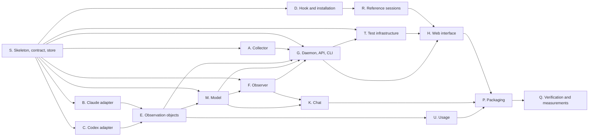

# MVP Implementation Plan

Status: accepted by the owner 2026-10-01. Basis: `rfc.md` (§4 sets the boundaries), ADR-0001…0012 (accepted), ADR-0013 (Windows support: the requirement, the Go hook handler and the remaining technical decisions accepted by the owner 2026-10-01).

## Execution rules

- **PR size.** A PR is logically coherent and reviewable: usually one or two plan items. There is no hard line limit (AGENTS.md). Recorded reference sessions are generated code and go in separate PRs without code.
- **Review.** Implementation and fixes are done by Claude Code sessions on Opus. Before merge, every PR goes through cross-review in a new Codex session on gpt-6-astra with reasoning xhigh.
- **ADR approval.** An aspect starts only after the ADRs in the "ADR" column of the table below are approved. ADR-0001…0012 are accepted. The Go hook handler (ADR-0013) is accepted, so D.1 does not wait for the rest of ADR-0013. Items that depend on other technical decisions of ADR-0013 (Windows specifics) start after those are approved.
- **Changes to shared packages after stage 0:**
  - `contract` — separate small PRs that are merged before the PRs that depend on them;
  - the `store` schema — until the first release it is edited in place by separate PRs in `store`, merged one at a time; migrations appear after the release;
  - table repositories are written by the aspect that owns the tables, in its own PRs (ownership table below).
- **Tests in the same PR.** PR acceptance is verified by tests from the same PR, CI green. Exceptions:
  - pure-type `contract` PRs — verified by type checking and by their first consumers;
  - infrastructure S.1a — verified by a CI run;
  - checks on real CLIs and checklists (A.5, D.5–D.8, F.3, Q) — a report in `docs/research/`; D.8 runs in GitHub Actions, the rest locally;
  - recordings of reference sessions (R.4) — verified by the R.5a and R.5b runs;
  - documentation (P.3).
- **Testing — per ADR-0012:**
  - mocks only at external boundaries (runtimes, LLM CLIs, third-party installation processes);
  - `engine` functional tests go through the real adapters;
  - failures are simulated with SIGKILL (`TerminateProcess` on Windows);
  - time thresholds in CI have headroom; strict ones live in tagged local benchmarks.
- **Platforms.** macOS, Linux and Windows (ADR-0013): CI runs a three-OS matrix; Windows specifics are part of the acceptance of the affected items.

## Overview

| Aspect | Packages | ADR | Starts after | Stage |
| --- | --- | --- | --- | --- |
| S. Skeleton, contract, store | all (skeleton), `contract`, `store` | 0001, 0004–0013 | ADR approval | 0 |
| A. Collector | `collector` | 0004, 0005, 0011, 0013 | S.2a, S.7 | 1 |
| B. Claude adapter | `adapter-claude` | 0004, 0006, 0009, 0010 | S.2b | 1 |
| C. Codex adapter | `adapter-codex` | 0004, 0006, 0009, 0010 | S.2b | 1 |
| D. Hook and installation | `hook` | 0004, 0011, 0013 | S.2a | 1 |
| R. Reference sessions and matrix | `tools/record`, `fixtures`, `support` | 0004, 0010, 0013 | D.1, D.2 | 1–2 |
| E. Intake and observation objects | `engine` | 0004–0006, 0008, 0009 | S.7, B.1, B.3 | 1 |
| M. Model and view | `engine` | 0005–0008 | S.3b, S.4a, S.6c | 1 |
| F. Observer | `observer`, `testkit/fake-cli` | 0002, 0007, 0010, 0013 | S.4a, S.6c | 1 |
| G. Daemon, API, CLI | `daemon`, `cli`, `catacomb` | 0003–0005, 0010, 0011, 0013 | S.5, S.6a | 1 |
| T. Test infrastructure | `testkit` | 0004, 0010, 0012 | S.2a | 1 |
| H. Web interface | `web` | 0008, 0011, 0012 | G.4, G.5, T.4, R.4 | 2 |
| K. Chat | `observer`, `engine`, `daemon` | 0007, 0008 | M.6, M.7, F.9, G.6 | 2 |
| U. Observer usage and report | `engine`, `daemon`, `cli` | 0009 | E.8, F.9, G.4 | 2 |
| P. Packaging | root, `catacomb`, `daemon` | 0011, 0013 | H, K, U | 3 |
| Q. Verification and measurements | — | 0010, 0013, RFC §9 | P | 3 |

### `store` table ownership

| Tables (ADR-0005) | Owner |
| --- | --- |
| raw records, facts, cursors with the scope decision, `gaps` | S.7 |
| observation objects, runs, links, `bindings` | E |
| model, journal, versions, `fact_interpretation`, `view_marks`, `attention_views`, `view_rules` | M |
| `observer_calls` | F |
| `chat_messages` | K |
| `settings` | G |

### Sessions and parallelism

- **Stage 0** — two sessions after S.1:
  - "contract" (S.1–S.5);
  - "store" (S.6–S.7).
- **Stage 1:**

  | Session | Aspects | When it starts |
  | --- | --- | --- |
  | 1 | A | after S.2a and S.7 |
  | 2 | B, then B.7, B.8 and B.9 | after S.2b |
  | 3 | C, then C.6 | after S.2b |
  | 4 | D, then R | after S.2a |
  | 5 | E | after B.1 and B.3; before them — preparation per the ADRs |
  | 6 | M | after S.6c |
  | 7 | F | after S.4a |
  | 8 | G.1, then T.1–T.3, then the rest of G | after S.5 and S.6a |

  Sessions E and M are not merged: G, F, K and H depend on them. Sessions G and T are merged because G.3 waits for E.1–E.3 and T fills that time; G.1 goes first because T.1 depends on it.
- **Stage 2:** H.1 is done by one session, then H splits into three lines (facts and attention; map and inspector; return, chat, usage). K is continued by session F, U by session E. B.7 and C.6 are done by sessions B and C right after R.4, before the full contract run R.5b. B.8 is done by session B after R.4b, B.9 after B.8.

**Critical path:**

S.1a → S.2a → S.2b → B.1, B.3 → E.1 → E.2 → E.3 → M.6 → G.3 → G.4, G.5 → T.4 → H.1 → H.4 → H.6 → H.8 → P → Q.

In parallel with it, the following must be ready in time:

- R.1 → R.2 → R.4 — consistent recordings for E2E;
- F.6 (version admission) → F.9 → G.6 — the observer in the daemon for H.4–H.6;
- D.6 → G.7 — the first real use of the trust check;
- K.2 — for H.8.

## Checkpoints

| Checkpoint | Scope | What the user sees | E2E (ADR-0012) |
| --- | --- | --- | --- |
| K1. Facts without an LLM | S; A; B.1–B.6; C.1–C.5; D.1–D.6, D.8; E.1–E.7c; M.1, M.6; G.1–G.5, G.7; T.1–T.5; R.1–R.5a; H.1–H.2 | runs, sessions, agents, actions, plan facts; explicit requests in the attention zone; support modes; source loss | 2, 9, 10, 12, 13 |
| K2. Semantic map | B.7–B.9, C.6, R.2b, R.2c, R.2d, R.4b, R.5b; D.9; M.2–M.5c; F.1–F.9; G.6; T.6; H.3–H.6, H.11 | stages, three axes, grounds, saved versions, inspector, persisted choice, LLM refusal, Codex with OTel | 1, 3, 7, 8, 14, 17 |
| K3. Return and chat | E.8–E.9; M.7–M.8; G.8–G.12; K; U; H.7–H.10, H.12 | "Since last review", chat, view rules, dismissing items, usage, restart | 4, 5, 6, 11, 15, 16, 18; variants by runtime and surface |
| K4. Delivery and support | F.10, P, Q | npm and Docker, support matrix, freshness and economics measurements | all; Q — on live sessions |

## Stage 0. Skeleton, contract, store (S)

- **S.1a Workspace and CI**.
  - Scope:
    - pnpm workspace, strict `tsconfig` with project references;
    - stubs of the 12 packages from ADR-0011;
    - Vitest workspace, Playwright config, `c8` coverage merging;
    - Go toolchain for `catacomb-hook`;
    - CI on GitHub Actions over a macOS, Linux and Windows matrix: install, types, tests, the E2E job.
  - Acceptance: `pnpm install && pnpm build && pnpm test` passes on a clean clone; CI green on three OSes.
- **S.1b Repository rules**.
  - Scope:
    - ESLint: the ADR-0011 dependency direction; `engine` tests are allowed to use adapters;
    - `tools/check-comments` — a ban on comments in TS, Go, SQL, YAML, CSS; exceptions are shebang and syntactically significant directives.
  - Acceptance: the checks fail on violating files of each language and pass on clean ones.
  - Tests: integration; the checks run over temporary files.
- **S.2a Contract: spool, raw records, interfaces**.
  - Scope:
    - branded ids;
    - the raw record envelope;
    - the spool file format (ADR-0004);
    - the adapter interface (`streamKey`, `rawKey`, `parse`) and the collector interface (`start`, batch, `ack`);
    - functions for deterministic fact and object ids (ADR-0005).
  - Acceptance: type checking; id stability is verified by the E.1 and E.9 functional tests (unit tests up front are not allowed, ADR-0012).
- **S.2b Contract: facts**.
  - Scope: the union of fact kinds with `entity_key`, `speaker`, `urgent` and per-kind payload schemas from ADR-0006, including the git snapshot, the JSON file snapshot, context and source loss.
  - Acceptance: type checking; the first consumers are B.1 and C.1.
- **S.3a Contract: observation objects**.
  - Scope: session, agent, action (code mode container), question, artifact version, git snapshot, usage record, gap, support mode.
- **S.3b Contract: model and journal**.
  - Scope:
    - run, stage, criterion, card, attention item, links;
    - execution axes, grounds with the interpreter, and human decisions;
    - journal entry and interpretation statuses;
    - marks and the view rule with closed selector variants.
- **S.4a Contract: observer protocol and JSON Schema**.
  - Scope: observer input and output; the ADR-0007 operations as closed `anyOf` variants; schema generation.
  - Acceptance: the schema respects the strict-mode constraints from ADR-0007 (an object at the root, `additionalProperties: false`, all fields in `required`, no free-form dictionaries, `oneOf`, `allOf`, `not`, `if`).
  - Tests: contract — checking the constraints against the generated schema.
- **S.4b Contract: chat and view rule**.
  - Scope: chat input and output with `needs` (ADR-0008), the rule proposal; schema generation from S.4a.
  - Acceptance and tests: as S.4a.
- **S.5 Contract: API, SSE, config, matrix**.
  - Scope:
    - DTOs of all ADR-0011 endpoints;
    - SSE events, including `reset`;
    - the `config.json` schema with defaults (runtime roots, watched roots, `lookback`, the collector with `fsWatch` and scan intervals, the observer with models, effort, `crossVendor` and budget, CLI paths, address, check contracts);
    - the `support/matrix.json` format with the key `(runtime, surface, OS, placement, engine version)`.
  - Acceptance: the default config loads and passes the schema.
  - Tests: integration — loading the config from a temporary directory.
- **S.6a Store: runner, lock, transactions**.
  - Scope: applying the schema with `PRAGMA user_version`; the single-writer lock file; a transaction helper; issuing `change_seq`.
  - Acceptance: a second writer is refused; a rollback leaves no partial rows; reopening changes nothing.
  - Tests: integration on real SQLite.
- **S.6b Store: raw layer schema**.
  - Scope: raw records, facts, cursors with the stream and the scope decision, `gaps`.
  - Tests: integration — key uniqueness, constraints.
- **S.6c Store: model and service table schema**.
  - Scope: objects, runs, links, bindings, blobs of ground versions, model, journal, versions, `fact_interpretation` (including `deferred`), marks with the "version and `change_seq`" pair, rules, chat, `observer_calls` with the base version, `pruned_streams`, `settings`.
  - Tests: as S.6b.
- **S.7 Store: raw layer repositories**.
  - Scope: insertion with deduplication by `dedupe_key`, facts, cursors with the scope decision, the "changes after `change_seq`" feed.
  - Acceptance: a repeated insertion reports "duplicate" and creates no rows; the cursor and the records are saved in one transaction.
  - Tests: integration.

## Stage 1. Parallel aspects

### A. Collector (`collector`)

- **A.1 Spool** (S.2a, S.7).
  - Scope:
    - fs watch on `spool/new` as a signal; listing the directory at startup, every 5 s, and right after an error, overflow or watcher close, recreating the watcher (ADR-0004, ADR-0013);
    - files handed out in a batch and not yet acknowledged are not handed out again;
    - header parsing; intake time is `mtime` in nanoseconds;
    - batches; `ack` deletes the file;
    - at startup — discarding files older than the retention period with a gap, and cleaning `spool/tmp`;
    - spool statistics.
  - Acceptance:
    - an event lands in a batch within ≤ 1 s in CI (≤ 100 ms locally);
    - with `collector.fsWatch: false`, a file that appears in `spool/new` without a notification and without a restart lands in a batch within the scan interval, is handed out once and is deleted only after `ack`;
    - without `ack` the file stays and is handed out again after a restart;
    - stale files are discarded with a gap.
  - Tests: integration on real files; the file format per S.2a.
- **A.2 JSONL tail**.
  - Scope:
    - recursive watch and a `stat` scan every 60 s and right after a watcher error or overflow;
    - while the runtime root does not exist, a watch on the nearest existing parent, and a watch on the root as soon as it appears (ADR-0004, decision 15; finding Q4-6, approved by the owner 2026-10-08);
    - a `stat` check every 1 s of files changed within the last 10 minutes by `mtime` or by an observed change of size or identity, without listing directories (ADR-0004, decision 14; finding Q4-1, approved by the owner 2026-10-07);
    - cursor `(path, dev, inode, offset, line number, size, ordinal)`;
    - only complete lines, `\r\n` allowed;
    - file identity via `fs.stat` with `bigint` (on Windows — the volume serial number and the NTFS index);
    - a read retry if the writing process holds a lock; a prolonged failure is a gap;
    - cursors are accepted at startup and returned in batches.
  - Acceptance:
    - appending, an incomplete last line, a split multibyte character and a restart from the cursor neither lose nor repeat lines;
    - with `collector.fsWatch: false`, appended lines are read within the scan interval;
    - files in roots created after startup, including together with the root's parent, are read within ≤ 5 s without a root scan, and through the real daemon;
    - lines appended through a descriptor the writer keeps open are read within ≤ 2 s without watch notifications and without a root scan, including with an `mtime` the write does not update, and a Codex rollout on macOS through the real daemon;
    - 500 files are tracked without misses.
  - Tests: integration on three OSes; split multibyte character — writing half a line to a real file, reading, appending the rest.
- **A.3 JSON file snapshots**.
  - Scope: `*.meta.json`, `teams/*/config.json`, `workflows/*.json`, the `sessions/*.json` registry; emitting a snapshot on a content change, and file disappearance events.
  - Acceptance: the sequence of registry snapshots reconstructed from the observation log `claude-code-transcripts/sessions-registry-lifecycle-observed.jsonl` is emitted without repeats.
  - Tests: integration.
- **A.4 OTel receiver**.
  - Scope: a separate listener on `127.0.0.1`, path `/otel/<token>/v1/logs`, a `200` response before processing, selecting `codex.tool_decision`.
  - Acceptance:
    - an OTLP request assembled from the `codex-otel/logs.tool_decision.variants.jsonl` records (wrapped in the envelope per `logs.envelope.tool_decision.approved-user.app-server.json`) produces records;
    - `logs.other-events.jsonl` events do not reach disk;
    - a wrong token — 404.
  - Tests: integration over HTTP.
- **A.5 Token path on a real `codex`** (locally, report).
  - Scope: `codex exec` against a Responses API stub with `-c otel.…` pointing to the token path.
  - Acceptance: the receiver gets `codex.tool_decision` with `source: Config` (ADR-0004).
- **A.6 Move, archive, loss** (B.3, C.1).
  - Scope:
    - detecting an inode change, file shrinkage and file disappearance;
    - finding the stream via the adapters' `streamKey`: Claude — in `projects/`, Codex — in `archived_sessions/`;
    - rereading; the `source_lost` signal.
  - Acceptance: a move to `*.superseded-*` and `codex archive` continue the stream; deletion produces `source_lost`.
  - Tests: integration with the real adapters.
- **A.7 Backfill and rereading**.
  - Scope: files without a cursor within `lookback`; `rescan(streams)` from the start on request from `engine`.
  - Acceptance: files older than `lookback` are not read; files with a cursor are read from the cursor; `rescan` rereads from the start.
  - Tests: integration.
- **A.8 Attachment files**.
  - Scope: reading the text files `tool-results/*` referenced by `persistedOutputPath`, on request from `engine`; saving them as a raw record with a hash.
  - Acceptance: Bash output moved out to a file is available after the original file is deleted.
  - Tests: integration.

### B. Claude adapter (`adapter-claude`)

Samples are in `docs/research/samples/`: `claude-code-hooks/`, `claude-code-transcripts/`, `claude-agent-sdk/`, `desktop/exp-cc-*`.

- **B.1 Hooks: tools and permissions**.
  - Scope:
    - `PreToolUse`, `PostToolUse`, `PostToolUseFailure`, `PostToolBatch`, `PermissionRequest`, `PermissionDenied`, `Notification`;
    - the surface from the environment header;
    - the content key for double delivery;
    - marking the observer's session.
  - Acceptance: every sample produces facts with the expected kind, session, agent and `tool_use_id`, if it is in the payload.
  - Tests: integration on samples; key fields are checked.
- **B.2 Hooks: session, turn, agents, compaction**.
  - Scope: `SessionStart` by source, `SessionEnd`, `UserPromptSubmit`, `Stop` with `background_tasks`, `SubagentStart`/`SubagentStop`, `PreCompact`/`PostCompact`, `InstructionsLoaded`, `TaskCreated`/`TaskCompleted`, `Elicitation*`; other events — a generic fact.
  - Acceptance and tests: as B.1.
- **B.3 Main stream transcript**.
  - Scope:
    - `streamKey` and `rawKey`;
    - `user`, `assistant`, `tool_use`/`tool_result` with `toolUseResult`;
    - service lines, `queue-operation`, `compact_boundary`, `isCompactSummary`;
    - `speaker`, `urgent`, version;
    - `thinking` does not get into the content;
    - `parse_state=unknown` for anything unknown.
  - Acceptance: `session-86f93ed5-main-full.jsonl` and `rec-*` parse without `invalid`.
  - Tests: integration.
- **B.4 Subagents, workflows, teammates**.
  - Scope:
    - the subagent transcript and meta (samples `subagent-agent-aad616394e806288d.{jsonl,meta.json}`);
    - the workflow journal and snapshot, `teams/*/config.json` — no samples, parsing marked unverified.
  - Acceptance: the subagent is linked to the `Agent` call by `meta.toolUseId` and `toolUseResult.agentId`.
  - Tests: integration.
- **B.5 Fork signs, plan, questions**.
  - Scope:
    - `uuid`, `message.id` and record times for the fork rule;
    - `ExitPlanMode` and task tools;
    - `AskUserQuestion` with `answers`;
    - `origin.kind`/`promptSource`.

    Parsing of the plan, answers and notifications without samples is marked unverified.
  - Acceptance: `session-cdfb3544-fork-full.jsonl` produces facts from which the boundary of the copied block is visible.
  - Tests: integration.
- **B.6 Usage, `cost-state`, registry**.
  - Scope: usage facts (`message.id`, tokens, `stop_reason`, `<synthetic>`); the `cost-state` total; registry snapshots with the `entrypoint: catacomb-observer` mark.
  - Acceptance: `rec-cost-state-all.jsonl` and the main stream records produce the expected keys and values.
  - Tests: integration.
- **B.7 Refinement from the reference sessions** (R.4). Elicitation, teammates and workflows are split out into B.8: R.2 has no scenarios for them, R.4 has no recordings. The split was accepted by the owner 2026-10-04 (#124).
  - Scope: remove the "unverified" marks from the plan, answers and background task notifications. There is no `TodoWrite` in the R.4 recordings: Claude 2.1.289 replaced it with `TaskCreate`/`TaskUpdate`, so its parsing stays unverified.
  - Acceptance: the PR adds its Claude scenarios to the existing R.5a run and runs them: no `unknown` among the covered types. R.5b then makes the whole set mandatory.
- **B.8 Elicitation, teammates and workflows from the reference sessions** (R.4b). The workflow journal was split out into B.9 by the owner's decision of 2026-10-07.
  - Scope: remove the "unverified" marks from `Elicitation`/`ElicitationResult`, the `elicitation_dialog`, `elicitation_url_dialog`, `agent_needs_input` notifications, teammates (team meta and config, `TaskCreated`/`TaskCompleted` with `teammate_name`) and workflows (snapshot, agent meta).
  - Acceptance: the PR adds the R.4b scenarios to the contract run as mandatory and runs them: no `unknown` among the covered types.
  - Stays unverified:
    - Windows TUI (`teammates`, `input-dialogs`): there is no manual recording by the owner, the cells are `unverified` per the R.2b applicability table;
    - `elicitation` in the Desktop engine: the R.4 engine is 2.1.286, the scenario needs 2.1.288 or newer.
- **B.9 Claude workflow journal** (B.8). Owner decision 2026-10-07: the journal is split out of B.8, and an addition to the ADR-0011 adapter interface is approved — `streamKey(path, first lines of the file)`. The lines of the `subagents/workflows/<run>/journal.jsonl` journal name neither the session nor the run, so a stream key cannot be built from the first lines alone and `engine` does not accept the journal.
  - Scope:
    - an addition to ADR-0011 and to the adapter interface in `contract`: `streamKey` receives the file path; `collector` and `engine` pass it;
    - the Claude adapter builds the journal stream key from the session and the run in the path; the Codex adapter does not use the path;
    - remove the "unverified" mark from the journal facts (`started`, `result`).
  - Acceptance: the contract run keeps the `launched`/`started`/`result` lines of the R.4b `workflow` recordings and produces the expected journal facts; journal intake continues after a daemon restart; there is no `unknown_stream_layout` gap.
  - Tests: integration and contract snapshots.

### C. Codex adapter (`adapter-codex`)

Samples are in `docs/research/samples/`: `codex-cli/`, `codex-sdk/`, `codex-otel/`, `desktop/exp-codex-*`.

- **C.1 Rollout: metadata and turns**.
  - Scope: `streamKey` (`session_meta.id`), `rawKey` (`thread_id`, `ordinal`), `session_meta`, `task_started`/`task_complete`/`turn_aborted`, `turn_context`.
  - Acceptance: `rollout-real-exec-then-resume-with-compaction.jsonl` parses without `invalid`.
  - Tests: integration.
- **C.2 Rollout: items and code mode**.
  - Scope:
    - `item_completed`: `CommandExecution`, `FileChange`, `AgentMessage` with `questions`, `UserMessage`, `ContextCompaction`, and also `McpToolCall` (no sample, unverified);
    - start by `function_call`/`custom_tool_call`;
    - the code mode cell as a container of nested commands.
  - Acceptance: every `codex-cli/rollout/` sample produces the expected facts.
  - Tests: integration.
- **C.3 Subagents, fork, compaction, usage**.
  - Scope: `SubAgentActivity`, `CollabAgentToolCall`, inter-agent messages; `compacted`; `token_usage_record` with `thread_id` from `session_meta.id`; `token_count` — only as non-summable.
  - Acceptance: `session_meta.fork.mock.json` produces `forked_from_id`; on the rollout sample, the sum of the usage records equals the last `thread_token_usage`.
  - Tests: integration.
- **C.4 Codex hooks**.
  - Scope: 12 events; `tool_use_id` = `call_id`; the subagent's `agent_id`; unwrapping the `{"_observed_env_CODEX_vars","stdin"}` sample wrapper.
  - Acceptance: the `codex-cli/hooks/` and `desktop/exp-codex-desktop-appserver-hooks.jsonl` samples produce the expected facts.
  - Tests: integration.
- **C.5 OTel, surface, self-exclusion**.
  - Scope:
    - `codex.tool_decision` with `source` split (`User`, `Config`, `AutomatedReviewer`);
    - the `originator × source` table;
    - marking the observer's sessions.
  - Acceptance: all OTel variants are recognized; the `session_meta.*` samples (exec, tui, guardian, subagent, `catacomb-observer`) are classified per ADR-0004.
  - Tests: integration.
- **C.6 Plan and refinement from the reference sessions** (R.4).
  - Scope: `thread_goal_updated` and rollout plan records; `McpToolCall`; the thread total without `token_usage_record`.
  - Acceptance: the PR adds its Codex scenarios to the existing R.5a run and runs them: no `unknown` among the covered types. R.5b then makes the whole set mandatory.

### D. Hook and installation (`hook`)

- **D.1 `catacomb-hook`** (S.2a; ADR-0013).
  - Scope: a Go executable per the ADR-0004 contract, built for macOS, Linux and Windows (amd64, arm64):
    - the spool path from a command argument;
    - a header with the registration tag and NUL separators;
    - the `spool/lease-<expiry>` lease and the `spool/stopped` stop marker;
    - observer markers;
    - draining stdin when exiting without a write;
    - `exit 0` per ADR-0013: argument parsing without `flag.ExitOnError`, top-level `recover`, streaming copy of stdin, one goroutine.
  - Acceptance:
    - the file appears in `spool/new` with a correct header;
    - exit 0, empty stdout and stderr in all branches;
    - no file with an observer marker, with a stop marker even with a valid lease, without a lease and with an expired lease;
    - exit 0 with no write and no output on a wrong number of arguments, an unknown runtime, a nonexistent or non-writable spool, a closed stdin;
    - stdin of tens of megabytes is written in full, exit 0;
    - CI thresholds with per-OS headroom; a tagged benchmark — p95 ≤ 10 ms for the binary launched the same way the runtime does it (Claude exec form): on macOS locally, on Linux and Windows — in D.8 on CI runners; on Windows the target is taken from CI (owner decision on PR #11). The end-to-end latency of the installed configuration is measured by D.5 and D.8. The Claude budget on Windows is p95 ≤ 25 ms (owner decision 2026-10-06, ADR-0013, decision 6).
  - Tests: integration on three OSes; coverage via `go build -cover`.
- **D.2 Claude plugin**.
  - Scope:
    - generating `<CATACOMB_HOME>/claude-plugin`: all events except `Worktree*`, `MessageDisplay` and `PreModelSwitch` (ADR-0004); `timeout: 2`; exec form — `command` with the absolute binary path, `args` with the runtime, the `plugin` tag and the absolute spool path from the current `CATACOMB_HOME`;
    - a copy of `catacomb-hook` (`catacomb-hook.exe` on Windows) in `<CATACOMB_HOME>/bin` unchanged; in-place update, moving the busy file aside on Windows (ADR-0013);
    - the local marketplace and `claude plugin`;
    - `uninstall`;
    - checking that the plugin is enabled.
  - Acceptance:
    - reinstallation is idempotent; the arguments of the `claude` calls match expectations; `uninstall` removes the plugin;
    - an overridden `CATACOMB_HOME` and a path with spaces and non-ASCII characters reach `command` and `args` undistorted;
    - updating the binary during continuous hook calls on three OSes: the command line in the plugin does not change, every launched call runs the old or the new binary and finishes with exit 0. On Windows a call in the window between the two renames may fail to start; that is a lost event, there is no exit code 2.
  - Tests: integration in a temporary HOME with a fake `claude`.
- **D.3 Codex hooks**.
  - Scope: an entry with the `user` tag and the absolute spool path only at the end of the arrays; the binary path in the command line is escaped for the runtime's shell: `sh` on macOS and Linux, PowerShell on Windows — `& '<path>' 'codex' 'user' '<spool>'` with single quotes doubled (D.8); stale catacomb entries are neutralized in place (`true`, on Windows `exit 0`); a backup copy; `uninstall` neutralizes catacomb entries.
  - Windows (owner decision 2026-10-06, ADR-0013, decision 7): `catacomb install` without flags does not install Codex hooks, and Codex sessions run in "files only" mode; `catacomb install --codex` installs them explicitly. `catacomb install` and `catacomb status` warn about a slowdown of 0.25–0.4 s per event.
  - Trust check on Windows: `codex app-server` is launched through the D.9 launcher in `stream` mode. The mode is not part of decision 7; it was accepted by the owner 2026-10-07 (ADR-0013, technical decision 4).
  - Acceptance:
    - the positions and contents of other parties' entries do not change — verified on `codex-cli/hooks/hooks.json.logger-config.json` and on a synthetic file with a stale `catacomb hook` entry;
    - reinstallation with an updated binary does not change the catacomb command line in `hooks.json`;
    - a path with spaces and non-ASCII characters in `CATACOMB_HOME` produces a working command line.
  - Tests: integration.
- **D.4 Trust and installation state**.
  - Scope:
    - an own `codex app-server` over stdio: `initialize`, `hooks/list`;
    - comparing the `trustStatus` of other parties' entries before and after installation;
    - a state function for the daemon and the CLI.
  - Acceptance:
    - the states "not installed", "untrusted", "active" are distinguished; a change in the trust of another party's entry aborts the installation with a rollback;
    - if the stop of the app-server tree is not confirmed within 10 s after the stop command, the check ends with an error, and the next check of the same `CODEX_HOME` does not launch the CLI until a late confirmation; a Windows launcher that exited without a status file is an immediate error and the same ban until the process restarts (ADR-0013).
  - Tests: integration with a fake `app-server` that responds per the `desktop/exp-codex-desktop-appserver-hooks-list.json` excerpt and per a constructed `trusted` variant.
- **D.5 Plugin delivery on live CLIs** (locally, script and report).
  - Scope:
    - the marketplace and the fallback directory `~/.claude/skills/catacomb/.claude-plugin/` in the CLI and in the SDK with default `settingSources`;
    - the plugin exec form on the installed Claude version;
    - runtime-side latency of the installed hook on macOS and Linux for both CLIs: a benchmark with the same launcher and the increase in time of a series of events with catacomb hooks relative to a series without them (ADR-0013);
    - Codex behavior on a hook timeout and a non-zero exit code.
  - Acceptance: the report confirms decision 1 of ADR-0004 or switches delivery to the fallback method; a budget overrun or blocking behavior is escalated to the owner.
  - Result: `docs/research/d5-plugin-delivery-live.md`. Tool — `tools/runtime-check`, the `delivery` suite.
- **D.6 Own `app-server` in the standard `~/.codex`** (locally, report).
  - Scope: side effects of `initialize` and `hooks/list` (sqlite, logs, MCP launch).
  - Acceptance: a report; if the effects are noticeable — an ADR-0004 amendment. Blocks G.7 and `doctor` in G.12: until the report, D.4 does not run on the standard `~/.codex`.
  - Result: `docs/research/d6-app-server-live.md`. Script — `docs/research/samples/codex-app-server-live/run.mjs`.
- **D.7 Early manual owner checklist** (instructions and a collection script).
  - Scope:
    - the spike checklists: section 11 (both Desktops) — on macOS; section 6, items a–h (interactive Claude TUI) — on macOS and on Windows. Done by the owner. Desktop on Windows is not verified in the MVP (ADR-0013, decision 3);
    - separate instructions for Windows with native commands (PowerShell, `%TEMP%` instead of `/tmp`, without Bash and `touch`); TUI — in the native Windows console; a run in WSL does not close the item;
    - the recorder is `catacomb-hook` into a temporary spool; the preparation script creates a valid lease in it, without which the hook writes nothing.
  - Acceptance: results in `docs/research/`; Desktop limitations are escalated to the owner (RFC §4) before stage 2.
  - Instructions: `docs/research/d7-owner-checklist.md` (macOS) and `docs/research/d7-owner-checklist-windows.md`. The preparation, collection and rollback script is `tools/owner-checklist`.
- **D.8 Runtime verification on Windows** (GitHub Actions, report; ADR-0013).
  - Method (ADR-0013, decision 4): real `claude` and `codex` are installed on a `windows-latest` runner and pointed at local fake model endpoints — Claude via `ANTHROPIC_BASE_URL`, Codex via a Responses API stub. No secrets are needed. Storage of real OAuth authorization on Windows is marked unverified.
  - Scope:
    - how Claude Code and Codex execute hook commands on Windows and which command line `catacomb-hook.exe` needs; Claude exec form; a profile with spaces and non-ASCII characters in the path;
    - runtime-side latency of the installed hook for both CLIs: a benchmark with the same launcher and the increase in time of a series of events with catacomb hooks relative to a series without them (ADR-0013);
    - Codex behavior on a hook timeout and a non-zero exit code;
    - transcript and rollout paths and formats, project directory encoding, line endings;
    - fs watch and file locks during reading;
    - CLI executables and `.cmd` shims, observer admission;
    - the CLI process tree in a Job Object per the D.9 launcher scheme: all processes are in the job and terminate together with it; processes the CLI spawns outside its tree (via OS services);
    - the strict `catacomb-hook` benchmark on Linux and Windows (D.1).

    Desktop data on Windows is not verified (ADR-0013, decision 3).
  - Acceptance: a report in `docs/research/`. Until the report, hook installation (D.2, D.3) and launching the observer (F.2, F.5) on Windows are not enabled; discrepancies found are added to ADR-0013. A hook budget overrun, blocking runtime behavior and CLI processes outside the launcher's job are escalated to the owner. Hook installation on Windows was enabled by the owner's decisions of 2026-10-06 (decisions 15 and 16 below).
  - Result: `docs/research/windows-runtimes.md`. Tool — `tools/runtime-check`, workflow — `Runtime check`.
- **D.9 Windows launcher** (D.1; ADR-0013).
  - Scope: an `catacomb-hook launch` mode of the same binary:
    - a Job Object with kill-on-close and without the right to break away from the job;
    - launching the CLI suspended, adding it to the job, resuming;
    - the first n bytes of stdin are the CLI input; closing stdin after them is the stop command;
    - `stream` mode (ADR-0013, technical decision 4, accepted by the owner 2026-10-07): the CLI input is all of stdin as it arrives, and its closing is the same stop command (`codex app-server`, D.3);
    - on the root's exit or on the command — terminating the job and waiting until no active processes remain in it;
    - then a status file with the root's exit code and the stop confirmation;
    - failure to create or assign the job — the CLI is not launched.
  - Acceptance:
    - the input reaches the CLI undistorted, the root's exit code gets into the status file;
    - the root exits leaving a descendant without shared pipes: the descendant terminates together with the job, the status file appears only after it exits;
    - closing the launcher's stdin, including by the exit of the process that launched it, terminates the whole tree;
    - external termination of the launcher (`TerminateProcess`) leaves no job processes, and no status file appears;
    - a hook call from the configs (first argument — the runtime) does not get into launcher mode;
    - in `stream` mode the CLI's response to the first line arrives before stdin is closed, and closing stdin stops the tree and produces the status file;
    - a launcher suspended from outside does not hold the caller longer than the stop confirmation period (D.4).
  - Tests: integration on Windows.

### R. Reference sessions and support matrix

- **R.1 Recording tool and anonymization** (D.1, D.2).
  - Scope:
    - `tools/record`: a temporary project;
    - the hook via `--plugin-dir` with a temporary spool and a valid lease in it;
    - collecting transcripts, rollouts, spool and JSON files with timestamps;
    - anonymization, including Windows paths (`C:\Users\<name>`, `%USERPROFILE%` in escaped JSON);
    - a manifest with the recording OS, control events and expected map changes (predicates or a description for the annotator, ADR-0007);
    - the recording directory `fixtures/sessions/<runtime>/<engine version>/<surface>/<OS>/<scenario>/` (ADR-0010).
  - Acceptance: the recording passes the anonymization check (no macOS, Linux or Windows home paths, emails, account or organization ids).
  - Tests: integration for anonymization and the manifest.
- **R.2 Claude scenarios**.
  - Scope: the ADR-0010 scenarios for the CLI (`-p`) and the SDK — on macOS, Linux and Windows; the Desktop engine in emulation — on macOS (Desktop on Windows is not verified in the MVP, ADR-0013). Permissions and questions go through a stdio host; the `AskUserQuestion` question, unavailable in `-p`, goes through an SDK host or a manual recording by the owner.
  - Acceptance: the scenarios are reproducible locally.
- **R.2b Claude scenarios: Elicitation, teammates, workflows** (R.2).
  - Scope: on the R.2 surfaces and OSes — an MCP server with form and URL elicitation and a host response; an agent teams team with a teammate and its tasks; a workflow with agents.
  - Acceptance: the scenarios are reproducible locally and verify that the behavior actually happened.
- **R.2c Scenarios for F.7d: agent and skill definitions, solver hooks, Codex roles** (R.2b, R.3). Owner decision 2026-10-05 on F.7d: recordings first.
  - Scope:
    - Claude on the R.2 surfaces and OSes: a plugin with an agent and a skill via `--plugin-dir`; a user hook with output that produces `hook_*` attachments and `system.stop_hook_summary` with a hook error;
    - Claude CLI and SDK: an agent defined for a single run (`--agents`, in the SDK the `agents` option); Desktop has no such definitions;
    - Codex exec on macOS, Linux and Windows: an agent role in `config.toml` (`[agents.<role>]`) and a subagent of that role next to a subagent without a role.
  - Acceptance: the scenarios are reproducible locally and verify that the behavior actually happened; the R.4b recordings are not part of the contract run before F.7d.
- **R.2d Codex Desktop question scenario** (R.3). Owner decision 2026-10-06 on H.12: E2E 4 needs a Codex Desktop recording with the solver's final answer (`phase: final_answer`) to verify the observer's question and the final-text card.
  - Scope:
    - the `question` scenario in Codex Desktop emulation on macOS, modeled on the Codex CLI and SDK `question`: the asynchronous question `request_user_input_async` and the user's answer as a second turn of the same thread;
    - the Responses API stub marks its text response `phase: final_answer`, as the model marks the last message of a turn.
  - Acceptance: the scenario is reproducible locally and verifies that the question and the final answers of both turns actually happened.
- **R.3 Codex scenarios** (D.3).
  - Scope:
    - scenarios with hooks on a Responses API stub in a temporary `CODEX_HOME`: exec, TUI via `expect`, subagent, fork, asynchronous question, approval with a decision via OTel, interruption;
    - a scenario with a real model without hooks: resume and compaction;
    - the same scenarios on Linux and, after D.8, on Windows. TUI on Windows — via a native ConPTY host in `tools/record` (for example, `node-pty`) or a manual recording by the owner; a run in WSL does not count as a Windows recording.
- **R.4 Recordings of current versions** (generated).
  - Scope: the versions installed at recording time (ADR-0010): currently Claude 2.1.286 (CLI, SDK), the Claude Desktop engine, Codex CLI 0.159.3, Codex SDK 0.159.3, a Codex Desktop build. CLI and SDK of both runtimes — on macOS, Linux and Windows; Desktop — on macOS. The recordings of each OS live in their own directory. The spike data for Codex 0.159.2 do not count as references for 0.159.3.
- **R.4b Recordings of the R.2b, R.2c and R.2d scenarios** (generated).
  - Scope: the R.4 versions, OSes and surfaces.
- **R.5a Contract run and matrix** (E.2–E.4).
  - Scope:
    - adapters and `engine` over `fixtures/sessions` → snapshots of facts and objects, ADR-0010 invariants;
    - generating and reading `support/matrix.json`;
    - the mandatory subset of scenarios: everything except the plan, answers to questions, teammates and workflows.
  - Acceptance:
    - an adapter regression breaks CI; a version outside the matrix gets `unverified`;
    - recordings of one scenario on different OSes coexist and run on each runner;
    - an OS row without its own recordings stays `unverified`, even if the recordings of another OS pass on its runner;
    - a Docker, VM or SSH-mode placement row stays `unverified` until the Q.1 check;
    - the Desktop rows on Windows are `unverified` ("not verified") in the MVP (ADR-0013, decision 3).
  - Tests: contract tests in CI.
- **R.5b Full contract gate** (B.7, C.6).
  - Scope: all ADR-0010 scenarios are mandatory; `unknown` among the covered types breaks CI. It does not wait for the R.4b scenarios: B.8 makes them mandatory.
  - Acceptance: the run is green on the R.4 recordings.

### E. Intake and observation objects (`engine`)

Tests feed raw records through the real adapters (ADR-0012).

- **E.1 Intake transaction** (B.1, B.3).
  - Scope:
    - `ingest(batch)`: adapters from the registry; raw records, facts, the cursor and the per-stream scope decision — in one transaction;
    - scope by the first `cwd` of the root session and by the shared git directory of a worktree;
    - discarding observer sessions;
    - the change feed.
  - Acceptance:
    - a session outside the roots leaves no rows;
    - a worktree of a watched repository is in scope;
    - after a SIGKILL of the child process (collector and `engine`) right after the commit, before `ack`, a restart creates no duplicates.
  - Tests: functional and integration with real git.
- **E.2 Merging observations** (B.2, C.1, C.2, C.4).
  - Scope:
    - sessions, agents and actions by the ADR-0006 keys;
    - merging hooks and files;
    - events without an occurrence identifier are not merged; identical events from different registrations within a 2 s window are linked as a "possible redelivery" (ADR-0004);
    - launches.
  - Acceptance:
    - a call from a hook and from the transcript is one action with the earliest time;
    - two identical `PermissionRequest`s of one registration with a close between them are two episodes;
    - mixed partial delivery from two registrations — both requests are visible, the group is marked ambiguous;
    - an event from two registrations — a marked group and a double-registration warning;
    - reordering spool files on restart does not change episode identifiers.
  - Tests: functional.
- **E.3 State, freshness, support modes**.
  - Scope:
    - turn state and waiting reasons (registry, `idle_prompt`, background tasks);
    - `quiet` (5 min), `lost`, dynamic `hooks_inactive`;
    - the "full", "files only", "hooks only" modes;
    - a counter of unrecognized records.
  - Acceptance: a session with files but without hook events gets `hooks_inactive`; silence does not change execution.
  - Tests: functional with controlled clocks.
- **E.4 Run linking: roots and agents**.
  - Scope: root sessions, resume, subagents, teammates, service agents, the false compaction `SubagentStop`, `/clear`.
  - Acceptance: the compaction agent does not become an agent; sessions with the same directory and without identifiers are not linked.
  - Tests: functional.
- **E.5 Run linking: forks, bindings, transfer** (M.1).
  - Scope:
    - the Claude fork rule, independent of intake order;
    - the list of shared origin;
    - Codex fork;
    - explicit bindings;
    - transferring a session between runs with a journal entry in both.
  - Acceptance:
    - the result is the same when the fork is read before and after the original, and also without the original;
    - a transfer returns the facts to the target run's queue.
  - Tests: functional with a permuted reading order.
- **E.6 Questions, decisions, attention items by rules** (M.1, B.2, C.5).
  - Scope:
    - the ADR-0008 opening and closing table: the end of waiting is separate from the resolution of the question;
    - the `PermissionRequest` ↔ `PreToolUse` link with an ambiguity mark;
    - decisions: OTel only with `source: User`, rules by subsequent events;
    - immediate closing of an auto-denial.
  - Acceptance:
    - the item is created in the same transaction as the request fact;
    - `source: Config` does not produce a human decision;
    - `permission` is closed by `turn_aborted` and by the end of the session as "wait ended without an answer";
    - an unanswered question survives the end of the session and the next prompt;
    - runtime waiting, resolution and dismissal are stored separately.
  - Tests: functional.
- **E.7a Contracts and checks** (M.1).
  - Scope: matching actions against contracts; checks; a failed check without a subsequent success and its attention item.
  - Acceptance: a failed and then successful check closes the item; a non-matching command does not count as a check.
  - Tests: functional.
- **E.7b Snapshots and version retention** (E.7a, A.8).
  - Scope:
    - ADR-0006 snapshots: `HEAD` and `git status --porcelain --ignored` by masks, with `GIT_OPTIONAL_LOCKS=0`;
    - blobs of ground versions: from the payload — as the action's version, from a file — marked "state at read time";
    - a size limit.
  - Acceptance:
    - an uncommitted, untracked or ignored file under a mask makes the snapshot unclean;
    - a report created via Bash that became a ground is readable after the source is deleted and after a restart, marked "state at read time";
    - the daemon does not create `index.lock`.
  - Tests: functional with a real git repository.
- **E.7c Confirmation and staleness** (E.7b).
  - Scope:
    - `confirmed` only by a contract that extracts the verified commit from the output of a successful check; the commit must exist in the repository;
    - in all other cases `passed_unversioned`; for two clean snapshots on the same `HEAD` — an informational mark;
    - `stale` when `HEAD` differs from the verified commit or the tree under the masks is not clean: on an fs watch signal, at the end of a turn and after a restart.
  - Acceptance:
    - a commit from the check output (the check runs in an isolated `git worktree`) gives `confirmed`, including when read by backfill;
    - a contract without commit extraction with a clean tree before and after gives `passed_unversioned` with the mark;
    - the input was changed after the first snapshot, the check read the changed input, the input was restored before the second snapshot — `passed_unversioned`, no confirmation;
    - an ignored or uncommitted input under a mask — `passed_unversioned`;
    - after confirmation, an edit without an fs watch notification is caught by the end-of-turn snapshot as `stale`.
  - Tests: functional with a real git repository; fs watch is disabled in some tests to verify missed notifications.
- **E.8 Solver usage** (B.6, C.3, E.5).
  - Scope: the solver journal per ADR-0009, aggregates, time.
  - Acceptance:
    - a Claude fork does not double the usage;
    - output without `stop_reason` is marked "at least";
    - the Codex sum matches `thread_token_usage`, except for forks;
    - the run duration is not equal to the sum of parallel agents.
  - Tests: functional.
- **E.9 `reparse` and projection rebuild** (E.2).
  - Scope: reparsing by `normalizer_version`; preserving ids; "Ground unavailable".
  - Acceptance: after `reparse` with a changed fact order, the model's references point to the same facts.
  - Tests: functional.

### M. Model and view (`engine`)

- **M.1 Journal and versions** (S.3b, S.6c).
  - Scope: model repositories; applying a change set (version, journal, projections); rebuilding by replaying the journal; entity change history for conflicts.
  - Acceptance: a rebuild by journal replay matches the original state; the version persists after a restart.
  - Tests: functional.
- **M.2 Operation validation: schema, references, scope, conflicts** (E.1).
  - Scope:
    - schema;
    - references and temporary ids, membership in the run;
    - no nesting or successor cycles;
    - `base_version` from `observer_calls`;
    - a conflict only on replacement, merge, split, target transfer or an edit of the same field by the user;
    - applying the response as a whole or rejecting it as a whole, returning all facts of the batch to `pending`.
  - Acceptance:
    - an invented id and another run's id are rejected;
    - `stage.nest(A, B)` after `stage.nest(B, A)` is rejected;
    - a substituted base version is rejected;
    - a rule changing a different field does not produce a conflict;
    - a fact shared by an accepted and a rejected operation does not get `interpreted`;
    - a restart between attempts returns `in_call` to `pending`.
  - Tests: functional; observer responses are fixtures.
- **M.3 Operation validation: grounds and invariants**.
  - Scope:
    - grounds by `speaker`;
    - checking `origin=plan`;
    - ADR-0007 invariants;
    - priority of the state observed by rules;
    - a report on rejected operations.
  - Acceptance:
    - "done" based only on the solver's words gives `claimed`;
    - an LLM does not get `observed`;
    - an attention item from rules cannot be closed by an operation.
  - Tests: functional.
- **M.4 Stage operations**.
  - Scope: `stage.*` with merge, split and replacement history.
  - Acceptance: a replaced stage is visible with a link to its replacement.
  - Tests: functional.
- **M.5a Binding operations and stage execution**.
  - Scope: `actions.assign`, `agents.participate`, `artifact.link`; stage execution by rule (active actions and active waits) and a contradiction with the LLM.
  - Acceptance: "completed" while an action is running is shown as a contradiction; a completed stage with a non-blocking question stays `done` with the decision `requested`.
  - Tests: functional.
- **M.5b Criterion, card, description operations**.
  - Scope: `criterion.add`, `criterion.assess` (interpretation only), `card.add` with coordinates, `brief.update`.
  - Acceptance: `criterion.assess` does not give `confirmed`; a card leads to a fragment of the original.
  - Tests: functional.
- **M.5c Attention operations and decision on a stage**.
  - Scope: `question.add`, `attention.add`, `attention.resolve` (only for observer items), `attention.likely_resolved` (for rule items), `attention.priority`; a human decision on a stage.
  - Acceptance:
    - a stage with an active human wait is `waiting`, decision `requested`;
    - `attention.resolve` for a rule item rejects the whole response;
    - `attention.likely_resolved` on an asynchronous Codex question sets a mark, and the item stays open.
  - Tests: functional.
- **M.6 Read queries** (E.2–E.4).
  - Scope: the run list, a snapshot with `change_seq`, the inspector, the diff between versions, observer calls.
  - Acceptance: a snapshot plus the change feed after it gives a state equal to the next snapshot.
  - Tests: functional.
- **M.7 View projection and rules** (E.2, E.8).
  - Scope: the tree, detail levels, selectors, `collapse`/`hide`/`group`, service agents collapsed by default, invariants, undo.
  - Acceptance:
    - a collapsed agent keeps its usage and result totals;
    - a hidden agent's question stays in the attention zone;
    - a rule applies to new elements.
  - Tests: functional.
- **M.8 "Since last review" and attention order** (E.6, M.5c).
  - Scope:
    - an atomic "version and `change_seq`" mark;
    - the diff by the model journal and by observation and attention objects;
    - marking and dismissing items;
    - ordering with an explanation.
  - Acceptance:
    - new events do not move the mark;
    - an artifact version and a rule-based question that appeared while the observer was unavailable get into the diff;
    - a dismissed item leaves the zone and stays in history;
    - an LLM recommendation does not change the order.
  - Tests: functional.

### F. Observer (`observer`, `testkit/fake-cli`)

- **F.1 Fake `claude`** (S.4a).
  - Scope:
    - checking the isolation flags;
    - `init` and `result` in the `observer/claude-stream-b-full-isolation.jsonl` format;
    - scripted responses with fact ids and `model_version` substituted from the input;
    - refusals;
    - recording the input.
  - Acceptance: without an isolation flag — an error; the response references ids from the input.
  - Tests: integration.
- **F.2 Claude launch** (D.9 for Windows).
  - Scope:
    - argv and environment per ADR-0007 with a per-OS list of variables (ADR-0013), `crossSessionInbound`;
    - on Windows — finding the real executable instead of the `.cmd` shim;
    - working directory `os.tmpdir()/catacomb-observer/empty` with an ancestor check;
    - `spawn` without a shell, parsing `stream-json`, checking `init`, the success flag;
    - a tree termination operation shared by all CLI launches (ADR-0013): a process group with an emptiness check on macOS and Linux, the D.9 launcher on Windows. On the root's exit, a timeout or a cancellation, the tree is terminated entirely; the slot is released only on a confirmed stop, otherwise `unavailable: process_stuck`;
    - usage.
  - Acceptance:
    - `subtype: success` with `is_error: true` is an error; an extra tool in `init` is a refusal;
    - the fake CLI launches a child process that keeps running and holds the inherited pipes; after a timeout on three OSes neither the root nor the descendant remains, the slot is free and the next call starts;
    - early root exit on three OSes: the fake CLI emits a successful `result` and exits before the timeout, leaving a live descendant without shared pipes (`stdio: 'ignore'`, `unref()`). The root's pipes are closed, but the slot is released only after the backend has terminated the descendant and confirmed the stop; at the moment of release there is no descendant, the next call starts;
    - the stop cannot be confirmed: on Windows the launcher was terminated from outside; on macOS and Linux an unreaped zombie remains in the group, whose parent has left the group. The slot stays busy, the backend is `unavailable: process_stuck`, the state with its reason is visible in `/api/status` and SSE, the next call does not start. On macOS and Linux, once the zombie is reaped, the slot is released.
  - Tests: integration with F.1.
- **F.3 Early measurement on real CLIs** (locally, report).
  - Scope: both backends with the spike profiles on `observer/observer-input.json`, 10 repetitions each; later — on R.4. The process tree of both CLIs in the observer profile on macOS and Linux: no descendant leaves the group.
  - Acceptance: a report with latency and usage distributions closes or refines questions 1–4 of ADR-0007; a descendant leaving the group is escalated to the owner (ADR-0013).
  - Result: `docs/research/f3-observer-measurement.md`. Script — `docs/research/samples/observer-measurement/run.mjs`. The measurement on R.4 stays with this item until the recordings appear.
- **F.4 Fake `codex`**.
  - Scope: `debug models --bundled`, `exec --json` with `-o`, an `unsupported` line in stderr; a real Responses API request to the self-check stub; a shell snapshot as in Codex 0.160.0: without `--disable shell_snapshot`, `exec` launches a descendant outside its process group (`setsid`). Both fake CLIs have a scenario where a descendant leaves the group under any profile (owner decision 2026-10-04 on F.3).
  - Acceptance and tests: as F.1.
- **F.5 Codex launch**.
  - Scope: generating the model catalog, the argv profile (paths in `-c` values with forward slashes; `--disable shell_snapshot` per the owner decision of 2026-10-04, ADR-0007, decision 10), parsing `--json` and `last.json`, rejection on `codex_core::tools::router: error=unsupported`; on Windows — finding the real executable or launching `node` with the package script; tree termination from F.2.
  - Acceptance:
    - `-m` matches the catalog `slug`; a call with a tool attempt is rejected;
    - a fake `codex` launched by a `node` wrapper with a script that spawns the real CLI process as a child, like the Codex npm package: after a timeout neither the wrapper nor the child process remains;
    - the wrapper exits before the timeout, and the CLI child process keeps running without pipes shared with it: the slot is not released until the backend has terminated the child process and confirmed the stop. On three OSes.
  - Tests: integration with F.4.
- **F.6 CLI version admission**.
  - Scope:
    - a Responses API stub and a temporary `CODEX_HOME`, the ADR-0007 conditions (`body.tools`, `input[additional_tools].tools`, probe calls);
    - Claude admission on a synthetic input: `init`, absence of a transcript, the registry marker, tools not being executed;
    - a control hook (not `catacomb-hook`) with positive and negative controls for both CLIs;
    - on macOS and Linux — checking every admission call with process table snapshots: no descendant has left the process group; a snapshot error is an admission failure. This is a safety net, not process accounting (ADR-0013, decision 3 on technical questions; amended by the owner decision of 2026-10-04 on F.3, ADR-0007, decision 10);
    - local admission status;
    - a ban on working calls before admission.
  - Acceptance:
    - non-empty tools disable the backend with a reason;
    - the control hook branches differ only by the hooks switch; for Codex both have the same test `--dangerously-bypass-hook-trust`. Without the switch the label appears, with it — it does not;
    - if `--disable hooks` or `--setting-sources ""` is removed from the negative branch, admission fails;
    - a descendant of an admission call leaves the process group — admission fails, backend `disabled: isolation` with a reason. This holds both for a descendant that terminates within the call and for a descendant that survives the group stop. If `--disable shell_snapshot` is removed from the Codex profile, admission fails. If a process table snapshot during the call failed, admission fails, even when the last snapshot succeeded;
    - the working observer profile does not contain a trust bypass;
    - a new version gets no working calls before admission;
    - a working call is not used as admission.
  - Tests: integration with F.1 and F.4.
- **F.7a Run context** (E.2, E.4).
  - Scope:
    - the allowed ADR-0007 sources that the existing adapter facts and files on disk provide: the task, instructions, Claude subagent definitions from `.claude/agents` files and the configuration directory, invoked skills, MCP servers, the branch and git snapshots; the remaining sources of the list — F.7d;
    - a `context` record with a hash, rewritten only on a change.
  - Acceptance: a skill gets into the context only when it is actually invoked; an unchanged context is not duplicated.
  - Tests: functional.
- **F.7b Batch packaging and prompt** (M.6).
  - Scope: the run description, a model snapshot, compression of low-value facts, a size limit, a system prompt based on `observer/observer-prompt.json`.
  - Acceptance: the input does not exceed the limit; all ids exist.
  - Tests: functional.
- **F.7c The `needs` protocol and input scope**.
  - Scope: resolving requests (raw records, actions, saved versions, context); a single scope filter and `crossVendor`; stripping thinking blocks. A material line is truncated to 16,000 characters (owner decision 2026-10-08, ADR-0007, decision 18).
  - Acceptance:
    - `needs` produces exactly one follow-up request;
    - a request for a record of another session outside the scope, or of another vendor without `crossVendor`, is not fulfilled;
    - thinking does not get into the input.
  - Tests: functional.
- **F.7d Solver hooks and definitions outside project files** (F.7a, B.7, C.6, R.4b). The split from F.7a was accepted by the owner 2026-10-03; per the owner decision of 2026-10-05, the R.2c scenario recordings come first.
  - Scope:
    - a fact with the solver hook name: the kind in `contract`, parsing of the `hook_*` attachments and `system.stop_hook_summary` of the Claude transcript from the R.4b recordings, for Codex — from the R.4 reference sessions;
    - agent definitions and skill descriptions of Claude plugins, definitions from the `--agents` flag;
    - Codex agent roles from the config;
    - `hook` records and these definitions in the F.7a run context.
  - Acceptance:
    - a solver hook from a reference session produces a `hook` record with its name;
    - a plugin subagent and a Codex role get a definition, a plugin skill gets a description;
    - a source whose format is not confirmed by a reference session does not get into the context.
  - Tests: functional through the real adapters.
- **F.8 Queue and batch launch** (M.2–M.5c, F.6).
  - Scope:
    - interpretation statuses;
    - launch conditions: size, timer, `urgent`;
    - no more often than once per 10 s per run;
    - one call per run, overall parallelism 2, a separate chat slot;
    - applying the result through M.2–M.5c.
  - Acceptance:
    - an urgent fact launches a call immediately;
    - an infrequent fact is processed by the timer;
    - a rejected response returns all facts of the batch to `pending`.
  - Tests: functional with fake CLIs and controlled clocks.
- **F.9 Failures, catch-up mode, budget**.
  - Scope:
    - the states `ok`, `lagging`, `backoff`, `unavailable`, `disabled`;
    - the ADR-0007 error table with separate counters and resumption conditions: `auth status` only after an authorization error, probes on a synthetic input after a limit and transient errors, a new admission after an isolation violation;
    - `not_interpreted` only after three content refusals or conflicts of the same batch;
    - the queue limit (2000 facts or 24 hours) and `deferred`;
    - catch-up mode with a compressed summary;
    - a budget with timer increase;
    - batch delays.
  - Acceptance:
    - three transient failures followed by a success do not make facts `not_interpreted`;
    - under a prolonged limit, a successful `auth status` does not resume calls, and probes go at a growing interval;
    - after an isolation violation, calls resume only after a new admission;
    - beyond the queue limit, facts get `deferred` with a visible gap;
    - a batch after three content refusals — `not_interpreted`;
    - exceeding the budget gives `lagging`, not a stop.
  - Tests: functional.
- **F.10 Isolation contract tests** (R.5a, F.6).
  - The scope adds to F.6 a check of `crossSessionInbound` with a peer session (Claude, locally).
  - Scope: Codex on a stub in CI with the CLI installed; Claude locally with a tag; writing the isolation column into the matrix.
  - Acceptance: the result for the current versions is written to `support/matrix.json`.

### G. Daemon, API, CLI (`daemon`, `cli`, `catacomb`)

- **G.1 Lifecycle** (S.5, S.6a).
  - Scope:
    - config; the `CATACOMB_HOME` layout with 0700 permissions on macOS and Linux and a profile ACL on Windows; the lock from `store`;
    - `catacomb start [--foreground]` with a detached process (`windowsHide` on Windows), `status`; a pid file;
    - `stop`: first the intentional stop marker `spool/stopped`, then `POST /api/admin/shutdown` — the daemon deletes the lease and exits. If the API is unavailable, `stop` deletes the lease itself and reports from the pid file whether the process is alive; a live process means the stop is not confirmed (ADR-0013);
    - `start` removes the marker after acquiring the lock; with the marker present the daemon neither creates nor renews the lease, deletes one created in a race and exits normally;
    - spool lease renewed every hour; a volume and marker check every minute, deleting the lease when the threshold is reached.
  - Acceptance:
    - a double `start` is rejected;
    - `start` creates the lease, `stop` deletes it and leaves the marker, `status` shows the marker;
    - `stop` after a SIGKILL of the daemon (`TerminateProcess` on Windows) deletes the lease, and the hook stops writing to the spool;
    - a live daemon with an unavailable API on three OSes: the daemon is suspended from outside (SIGSTOP on macOS and Linux, process suspension on Windows), `stop` deletes the lease and reports that the process is alive and the stop is not confirmed; `start` is rejected meanwhile, the marker stays. The daemon is resumed and goes through the renewal and volume check cycle (short intervals in the test config): the lease does not appear, the hook does not write to the spool, the daemon exits on its own. The next `start` removes the marker, and writing resumes;
    - when the threshold is exceeded, the lease is deleted within a minute, a gap is written, and the actual spool volume and the growth after the threshold are visible in `status`;
    - after a SIGKILL of the daemon, writing stops when the lease expires — verified with a short lease period.
  - Tests: integration with a real process in a temporary HOME on three OSes.
- **G.2 Authorization and static files**.
  - Scope:
    - token, bearer;
    - one-time link → cookie `HttpOnly; SameSite=Strict`;
    - `catacomb open`, `token rotate`;
    - address `127.0.0.1` and `--bind`;
    - serving the `web` static files from the same origin;
    - CSRF protection: a mutating cookie request is accepted only from the daemon's page and with JSON (ADR-0003, decision 1).
  - Acceptance: a request without a token — 401; a one-time link works once; static files are served only after authorization; a mutating cookie request from another origin — 403, with a type other than JSON — 415; a CLI request with a bearer goes through.
  - Tests: integration over HTTP.
- **G.3 Intake composition** (A.1–A.4, E.1–E.3).
  - Scope: collector → `engine.ingest` → `ack`; adapter registration; the OTel listener.
  - Acceptance:
    - a transcript line and a hook event from a temporary HOME become objects;
    - an authorized `POST /api/admin/shutdown` during intake on three OSes: the current transaction completes, the lease is deleted, files without `ack` remain in the spool and are taken in without duplicates after startup;
    - shutdown without a token — 401, the daemon keeps running.

    Forced termination verifies recovery (E.1, E2E 6), not a normal stop.
  - Tests: integration.
- **G.4 Read API** (M.6).
  - Scope: `/api/status` (base), `/api/runs`, snapshot, inspector, facts and raw records, saved artifact versions, observer calls, `changes` from the "version and `change_seq`" pair.
  - Acceptance: the responses match the DTOs from S.5.
  - Tests: integration over HTTP.
- **G.5 SSE**.
  - Scope: `/api/stream?run=`, `Last-Event-ID`, `reset` on a stale position.
  - Acceptance: reconnection neither loses nor repeats events; a stale position gives `reset`.
  - Tests: integration.
- **G.6 Observer composition** (F.6, F.9, M.2–M.5c).
  - Scope: the scheduler in the daemon; the backend by the vendor of the root session; `crossVendor`; CLI paths from the config; the observer state in `/api/status` and SSE.
  - Acceptance: facts of a Codex session in a Claude run without `crossVendor` are not sent and are visible as a gap.
  - Tests: integration with fake CLIs.
- **G.7 Connection state** (D.4, D.6, E.3, R.5a).
  - Scope: support modes (static from D.4, dynamic from E.3, matrix from R.5a); spool and lease; the "Not observable" notification; unverified versions and the observer admission status.
  - Acceptance: `/api/status` distinguishes "not installed", "untrusted", "hooks inactive in the session", `unverified`.
  - Tests: integration.
- **G.8 Write API: viewing, rules, bindings** (M.7, M.8, E.5).
  - Scope: the run mark with the "version and `change_seq`" pair, marking and dismissing an item, view rules, bindings.
  - Acceptance: a binding transfers the session and updates both runs via SSE; dismissing an item changes nothing in the model.
  - Tests: integration.
- **G.9 Scope: `watch` and `unwatch`** (A.7, E.1).
  - Scope: `--lookback`, `--all`; rereading previously discarded streams.
  - Acceptance: after `watch`, the project files within `lookback` are reread despite the cursors.
  - Tests: integration.
- **G.10 `prune`**.
  - Scope: cascading deletion of a run's layers in `store`, `VACUUM`; the deletion boundary in `pruned_streams`, respected by backfill, `rescan`, recovery after a move, and the spool; "start pruned".
  - Acceptance:
    - `prune` → `codex archive` or a Claude move → restart: what was deleted does not come back;
    - `prune` → a Claude file with the same `sessionId` shrunk or replaced with new records → stream intake stopped with a gap, new records are not silently discarded;
    - continuing the session creates a run with a mark;
    - spool files of a deleted session with a time before the deletion are discarded.
  - Tests: integration.
- **G.11 `reparse`** (E.9).
  - Scope: the endpoint and the command.
  - Acceptance: a repeated call is idempotent.
  - Tests: integration.
- **G.12 CLI commands**.
  - Scope:
    - `watch`/`unwatch`, `bind`, `prune`, `reparse`;
    - `install`/`uninstall` via `hook`;
    - `otel-config [--rotate]`;
    - `doctor`: installation, trust, versions, observer checks, a busy OTel exporter.
  - Acceptance: `doctor` shows inactive hooks, unverified versions and an exporter conflict.
  - Tests: integration against a running daemon.

### T. Test infrastructure (`testkit`)

- **T.1 Temporary HOME and daemon launch** (S.2a, G.1).
  - Scope:
    - a builder for `.claude`, `.codex`, `.catacomb` and the config;
    - the temporary profile environment: `HOME` and `USERPROFILE` (on Windows `os.homedir()` takes it), explicit `CLAUDE_CONFIG_DIR`, `CODEX_HOME` and `CATACOMB_HOME`;
    - launching the built daemon, waiting for readiness, stopping via the shutdown API.
  - Acceptance: parallel tests are isolated.
  - Tests: integration.
- **T.2 File player**.
  - Scope: the manifest format; JSONL with timestamps; JSON files; time scale; deletion, move, archive.
  - Acceptance: a played file matches the source byte for byte; intervals are respected.
  - Tests: integration.
- **T.3 Hooks and OTel player** (D.1).
  - Scope: calling the real `catacomb-hook` with a payload, a tag and an environment, including double registration; without a running daemon — a temporary spool with a valid lease; OTLP requests.
  - Acceptance: hook events reach the spool in the original order; double registration produces two files with different tags.
  - Tests: integration.
- **T.4 Playwright fixtures and coverage** (G.2–G.5, T.1–T.3, F.1, F.4).
  - Scope: a temporary HOME, the daemon, the player, a fake CLI scenario, an authorized context; merging the daemon's V8 coverage; the E2E job in CI.
  - Acceptance: after a sample is played, the run is visible through the Playwright `request` in `/api/runs`.
  - Tests: an E2E example via the API.
- **T.5 Scenarios from samples**.
  - Scope: manifests for spike samples that do not need merging of hooks and files: a transcript with a subagent, a fork, compaction, Codex with resume and compaction, OTel.
  - Consistent scenarios with hooks and files are taken from R.4.
- **T.6 Observer scenarios** (F.1, F.4).
  - Scope: observer and chat responses for E2E 1, 3, 4, 5, 7, 8 with ids substituted from the input.
  - Acceptance: the scenarios pass the M.2–M.3 check on the corresponding recordings.
  - Tests: functional.

## Stage 2. Interface, chat, usage

### H. Web interface (`web`)

The E2E tests of every PR run on top of the real daemon, the player and a fake CLI (T.4). Consistent sessions are taken from R.4.

- **H.1 Shell**.
  - Scope:
    - cookie login, the run list;
    - an SSE client handling `reset`;
    - the status bar: the observer and the model age, support modes, source loss, unverified versions, unrecognized records, spool, "Not observable".
  - Acceptance: E2E 13, 9.
  - The status bar is superseded by ADR-0015: observation health is a dot in the header (V.5).

**Line "facts and attention"**

- **H.2 View before meaning**.
  - Scope: sessions, agents, actions, plan facts; freshness (`quiet`, `lost`, waiting); the attention zone with rule items.
  - Acceptance: E2E 2, 10, 12.
  - The run view of sessions, agents, actions and plan facts and the attention zone are superseded by ADR-0015 (V.2, V.4). Freshness (`quiet`, `lost`, waiting) and the compaction rule stay in the engine and are covered without E2E: E2E 2 by `attention-badges.test.ts`, E2E 10 and 12 by functional tests (coverage table).
- **H.3 Attention zone** (M.8).
  - Scope: ordering with an explanation; the "recommended" label; marking and dismissing an item; "from a hidden element"; the "session ended" mark.
  - Acceptance: E2E 3 (attention part), E2E 15 (after G.8).
  - Superseded by ADR-0015: attention is a badge on the stage, a header chip and a count in the chat list, without viewed or dismiss controls (V.4).

**Line "map and inspector"** (after G.6 and T.6)

- **H.4 Map: layout**.
  - Scope: React Flow and ELK; nesting with expansion; dependency edges differ from temporal order; axes — by a label and an icon.
  - Acceptance: E2E 1 (map part).
- **H.5 Map: updates and selection**.
  - Scope: preserving the selection and scroll; navigating to a successor; a stable layout.
  - Acceptance: E2E 14.
- **H.6 Inspector**.
  - Scope: summary, expected result, inputs and outputs with saved versions or the "reference only" mark, time, usage, the "ground → fact → raw record" chain, history, criteria with snapshots and the `passed_unversioned` status, rejected observer responses.
  - Acceptance: E2E 1, 3, 17.
  - Superseded by ADR-0015: selecting a stage narrows the chat and shows the stage summary (V.3).

**Line "return, chat, usage"**

- **H.7 "Since last review"** (G.8).
  - Scope: the mark, the diff with grounds, cards with a link to the original.
  - Acceptance: E2E 4, 16.
  - Superseded by ADR-0015: the mode is removed from the UI; the chat answers "what changed" questions (V.2).
- **H.8 Chat and view rules** (K.2).
  - Scope: a chat panel scoped to a stage; links; a version label; a list of rules with undo.
  - Acceptance: E2E 5, 18.
  - The list of rules is superseded by ADR-0015: active rules are filter chips above the map (V.4).
- **H.9 Usage** (U.1).
  - Scope: three journals; attributed and unattributed parts; "total per Claude Code data" with a note about the exit; lower bounds.
  - Acceptance: E2E 11.
  - Superseded by ADR-0015: the usage page is removed from the UI; `catacomb usage` stays (V.2).

**End-to-end E2E**

- **H.10 Restart** (G.8, H.7): E2E 6.
- **H.11 Codex: LLM refusal, OTel, fork** (G.6, R.4): E2E 7, 8.
- **H.12 Variants by runtime and surface** (R.4): Codex variants for E2E 1, 5; Desktop and SDK variants for E2E 1. The E2E 4 variants are removed with the "Since last review" mode (ADR-0015, V.2).

### K. Chat

- **K.1 Chat call** (M.6, F.7c, F.9, G.6).
  - Scope: input, system prompt, the schema from S.4b, a two-phase call with `needs` through F.7c on the same snapshot, citation checking, binding to a version, storage, SSE, the chat slot.
  - Acceptance:
    - a question about an old ground outside the first input gets an answer with a link to it via `needs`;
    - both phases use the same map version;
    - an invalid citation is removed with a mark;
    - "not enough data" reaches the UI.
  - Tests: integration with fake CLIs.
- **K.2 View rule from chat** (M.7, G.8).
  - Scope: selector validation, application, the number of affected elements, undo.
  - Acceptance: an invalid selector is rejected with an explanation.
  - Tests: functional and integration.
  - The list of active rules is superseded by ADR-0015: rules are filter chips above the map (V.4). Validation, application and undo stay.

### U. Observer usage and report

- **U.1 Observer and chat journals, report** (E.8, F.9, G.4).
  - Scope: usage and latency of calls; usage per active hour; the API and `catacomb usage`.
  - Acceptance: the three journals are not mixed; an active hour is counted by solver activity.
  - Tests: integration.
  - The usage UI is superseded by ADR-0015: the journals, the API and `catacomb usage` stay (V.2).

## Stage 3. Delivery and verification

### P. Packaging

- **P.1 npm package**.
  - Scope: an `esbuild` build, the `web` static files, the `catacomb` command, `engines.node`; the `catacomb-hook` binaries as optional packages `catacomb-hook-<os>-<arch>`.
  - Acceptance: `npm pack` → installation into a temporary prefix → `catacomb start`, `status`, `open` and `install` in a temporary HOME with fake CLIs on three OSes.
  - Tests: smoke in CI on macOS, Linux and Windows.
- **P.2 Docker image**.
  - Scope: `node:26-slim` with catacomb as a base layer for the solver image.
  - Acceptance: in a derived image with fake CLIs, the player writes a sample and the API returns the run.
  - Tests: smoke in CI.
- **P.3 Installation documentation** (documentation).
  - Scope:
    - installation, `watch`;
    - the SDK boundary and opt-in via `plugins`;
    - OTel;
    - SSH tunnel;
    - Docker;
    - removal.

### Q. Verification and measurements (RFC §9, spike 13.3)

- **Q.1 End-to-end surface matrix.**
  - Scope:
    - owner checklists (D.7 again on the release versions: Desktop — on macOS, TUI — on macOS and Windows);
    - native Windows: both CLIs and both SDKs; Desktop on Windows is not verified in the MVP and stays "not verified" (ADR-0013, decision 3);
    - Docker and an own VM, Desktop SSH mode;
    - the OAuth path on Linux;
    - updating the matrix.

    Desktop limitations are escalated to the owner.
  - Result: `docs/research/q1-surface-matrix.md`. Tool — `tools/surface-check`, workflow — `Surface matrix`. Owner checklists — `docs/research/q1-owner-checklist.md` (macOS, Desktop SSH mode, OAuth on Linux) and `docs/research/q1-owner-checklist-windows.md`. Evidence of the placement and checklist verifications for the matrix — `support/verification.json`.
- **Q.2 Freshness.**
  - Scope:
    - the `tools/freshness` tool: time until the expected map change is fulfilled per the manifest predicates, an annotator assessment for the remaining control events, unfulfilled expectations as violations, the share of time spent on follow-up requests;
    - the load profile is fixed before the measurement;
    - p95 of the semantic update and the full latency from `source_ts` with the real observer on this profile;
    - parallel runs, exhaustion of subscription limits, degradation on failure.
  - p95 targets based on F.3: 30 s for runs with a Claude observer and about 40 s for Codex runs with a Codex observer (ADR-0007, decision 11). Observer effort until Q.2 is the CLI default (ADR-0007, decision 12).
  - Result: a report, a decision on the RFC §8 targets for both backends and on effort. Owner decision 2026-10-08: the default Claude observer effort is `low`, Codex uses the CLI default; the target of about 40 s for Codex is confirmed, for Claude, after a repeat measurement, about 35 s (ADR-0007, decisions 14, 15 and 17).
- **Q.3 Economics.**
  - Scope: observer and chat usage per active hour, one-time and recurring costs separately.
  - The observer token budget is not limited until Q.3 (ADR-0007, decision 13). Result: a decision on the default budget. Owner decision 2026-10-08: the default budget is unlimited (ADR-0007, decision 16).
- **Q.4 Resilience on live sessions.**
  - Scope:
    - daemon restart;
    - loss and move of sources;
    - hooks and trust failure;
    - divergence between hooks and files;
    - ambiguous lineage.
- **Stage outcome.** Announcement of support by version (ADR-0010) and the owner's decision on moving to the RFC §9 product validation.

## Stage 4. UI simplification (ADR-0015)

The web UI is reduced to a chat list, a full-screen stage map and a collapsible chat panel. Design: `docs/superpowers/specs/2026-10-12-ui-simplification-design.md`; tasks: `docs/superpowers/plans/2026-10-12-ui-simplification.md`. The PRs of this stage merge only after the owner accepts ADR-0015.

### V. Simplified interface (`web`, `contract`, `engine`)

- **V.1 `RunSummary.cwd`** (plan, Task 2).
  - Scope: `cwd` of the root session in `RunSummary`.
  - Acceptance: `runs.test.ts`, "a run summary carries the working directory of its root session".
- **V.2 Two-column run screen and collapsible chat** (plan, Task 3).
  - Scope: the map and the chat panel beside it; the panel collapses to a rail and keeps the state across reloads; an overlay sheet on a narrow screen; the facts header, trace, plan facts, "Since last review", the changes mode and the usage pages are removed; old `view=usage` and `mode=changes` links open the remaining screens.
  - Acceptance: `layout.test.ts`.
- **V.3 Stage selection focuses the chat** (plan, Task 4).
  - Scope: the inspector is removed; selecting a stage shows its summary at the top of the chat panel and narrows the chat; "whole run" clears it.
  - Acceptance: `stage-focus.test.ts`.
- **V.4 Node card, attention badges and filter chips** (plan, Task 5).
  - Scope: the card shows name, execution state, basis and an attention badge; open items without a stage are a header chip; the attention zone is removed; active view rules are chips above the map, ✕ revokes the rule.
  - Acceptance: `attention-badges.test.ts`; the filter chip scenarios in `chat.test.ts`.
- **V.5 Health dot** (plan, Task 6).
  - Scope: one dot in the header while a non-coverage lamp is not normal, with a popover listing the problems; the status strip and the lamp row are removed.
  - Acceptance: the health dot scenarios in `shell.test.ts`.
- **V.6 Compact chat list and the web README** (plan, Task 7).
  - Scope: a row with the goal, the project folder, the state, "waiting for you: N" and the relative time, newest first; `packages/web/README.md` describes the new screens.
  - Acceptance: the chat row scenario in `shell.test.ts`; the waiting count in `attention-badges.test.ts`.

## RFC scenario coverage

| Requirement | E2E | Where implemented |
| --- | --- | --- |
| During work: active stages, waits, changes, freshness (RFC §2) | 1 (map), 7, 8; `layout.test.ts`, `stage-focus.test.ts`, `attention-badges.test.ts` | E.1–E.3, M, F, G.6, H.4–H.5, V.2–V.4 |
| After an iteration: unresolved questions after the end of the session stay on their stages and in the header chip; "what changed" is asked in the chat (RFC §2, §5; ADR-0015) | 5, 18; `attention-badges.test.ts` | E.6, M.5b–M.5c, M.8, K, V.4 |
| Chat with links and view rules as filter chips (RFC §4, §5) | 5, 18; filter chip scenarios in `chat.test.ts` | K, M.7, H.8, V.4 |
| Preserving the selection, color with a label (RFC §5) | 14; `stage-focus.test.ts` | H.4–H.5, V.3–V.4 |
| Links, fork, three axes, grounds, criterion confirmation on the established version (RFC §6) | 1 (map), 8; criterion confirmation without E2E: `engine/test/criteria.test.ts`, `engine/test/check-contracts.test.ts`, `engine/test/results.test.ts` | E.4–E.7c, M.2–M.5c |
| Saved artifact versions and access to sources (RFC §6, §7) | 18 | A.8, E.7b, F.7c, K.1 |
| An explicit input request without an LLM, LLM refusal, restart without duplicates (RFC §8) | 6, 7; `attention-badges.test.ts` | A, E.1, E.6, F.9, V.4 |
| Separate usage (RFC §8) | — (`catacomb usage`) | E.8, U |
| Secured access (ADR-0003) | 13 | G.2, H.1 |
| Gaps are visible: hooks, source, version (RFC §7) | 9; health dot scenarios in `shell.test.ts` | A.6, E.3, G.7, R.5a, V.5 |
| Desktop and SDK surfaces (RFC §4) | variants 1 | R.2, R.2d, R.4, R.4b, H.12, Q.1 |
| Freshness: waiting for a human, no new events, source lost; a false compaction `SubagentStop` is not an agent (old E2E 10, 12; RFC §6, §8, ADR-0006) | — (covered without E2E) | E.3, E.4: `engine/test/session-freshness.test.ts`, `engine/test/sample-scenarios.test.ts`, `adapter-claude/test/session-hooks.test.ts` |
| Chat list with the project folder and the waiting count (ADR-0015) | `runs.test.ts`, chat row scenario in `shell.test.ts` | V.1, V.6 |

ADR-0015 removes the views that E2E 2, 4, 10, 11, 12, 16 and 17 and the inspector part of E2E 1 went through; their files (`facts-view`, `attention-zone`, `inspector`, `inspector-selection`, `since-last-view`, `since-last-view-variants`, `usage`) are deleted in V.2–V.4. E2E 3 (its attention part) and E2E 15 are not removed: `attention-badges.test.ts` carries them on badges and the header chip. The engine and API behaviour behind them is unchanged and keeps its functional and integration tests.

## Owner decisions

Accepted by the owner 2026-10-01:

1. The 400-line PR size limit is cancelled in the project: PRs are logically coherent and reviewable, one or two plan items each. Recorded reference sessions are generated code.
2. Up to eight parallel sessions: two in stage 0, eight in stage 1 per the table above.
3. CI is GitHub Actions over a macOS, Linux and Windows matrix; `codex` is installed in CI for the isolation test on a stub.
4. The manual Desktop and TUI checklists (D.7) are done by the owner in stage 1, on macOS and Windows.
5. The observer on a Claude version is enabled with a mark after automatic admission (ADR-0007, decision 7), so live use does not wait for F.10 for each new version.
6. The MVP supports native Windows (ADR-0013); the D.8 check is done in stage 1.
7. The `catacomb-hook` hook handler is a native Go binary for all OSes, an exception to ADR-0001 (ADR-0013).

Accepted by the owner 2026-10-02:

8. D.8 runs in GitHub Actions on `windows-latest`: real `claude` and `codex` on the runner, a fake model endpoint (Claude — `ANTHROPIC_BASE_URL`, Codex — a Responses API stub), a report in `docs/research/` based on the CI results. Storage of real OAuth authorization on Windows is marked unverified (ADR-0013, decision 4).
9. Claude Desktop and Codex Desktop on Windows are not verified in the MVP; the support matrix has an explicit "not verified" mark. This narrows RFC §4 (ADR-0013, decision 3).
10. A spool file with an unrecognized header stays in the spool with a gap and is discarded after the `spool.maxAgeDays` period (ADR-0004, decision 11).
11. The strict `catacomb-hook` benchmark on native Linux and Windows is in D.8; on Windows the target is taken from CI (decision on PR #11, ADR-0013, decision 5).

Accepted by the owner 2026-10-04 based on the F.3 report (`docs/research/f3-observer-measurement.md`, section 2):

12. The Codex observer profile disables the shell snapshot (`--disable shell_snapshot`), and the F.6 version admission checks that no descendant left the process group during the call (ADR-0007, decision 10; ADR-0013, decision 3 on technical questions).
13. The p95 freshness target for Codex runs with a Codex observer is about 40 s, for Claude — 30 s; the final check is Q.2 (ADR-0007, decision 11).
14. Observer effort is not fixed until Q.2, the token budget is not limited until Q.3 (ADR-0007, decisions 12 and 13).

Accepted by the owner 2026-10-06 based on the D.8 report (`docs/research/windows-runtimes.md`, section 2):

15. The `catacomb-hook.exe` budget for Claude on Windows is p95 up to 25 ms per event; on macOS and Linux it is still 10 ms (ADR-0013, decision 6).
16. Codex hooks on Windows are not installed by default: Codex sessions run in "files only" mode (ADR-0004), approval waits are not visible. The explicit flag `catacomb install --codex` enables hooks; `catacomb install` and `catacomb status` warn about a slowdown of 0.25–0.4 s per event (ADR-0013, decision 7).

Accepted by the owner 2026-10-07 based on the Q.4 report (`docs/research/q4-live-resilience.md`, section 2):

17. Loss of hooks mid-session (Q4-4) is fixed in the MVP: a turn visible in the files without hook events for longer than `freshness.hooksInactiveAfterMs` opens a `hooks_inactive` gap and switches the session to "files only" mode until the next hook event (ADR-0004, decision 12).

Approved by the owner 2026-10-08 based on the Q.2 and Q.3 report (`docs/research/q2-q3-live-measurement.md`, section 2; PR #163):

18. The default Claude observer effort is `low`. The p95 freshness targets are confirmed: 30 s for Claude runs, about 40 s for Codex runs. The Codex observer effort is the CLI default. The default token budget is unlimited (ADR-0007, decisions 14–16). Effort `low` is verified by a repeat measurement with two parallel runs; the result is appended to the report.
19. The observer prompt immediately lays out an explicit plan (PLAN.md, a task list) into planned stages. After the edit, plan reflection is checked for Claude and for Codex.
20. The UI shows the run goal `run.goal` (the first prompt, ADR-0006) next to the brief, and the requirement "the brief names the goal" is removed from the measurement annotation.
21. A Claude observer call without writing the changing part of the input to the cache is investigated separately: the cost per CLI data for the same input, and separately the total number of tokens.
22. The measurement load recordings are kept outside the repository by the owner; the report identifies them by digests.

Approved by the owner 2026-10-08 based on the Q.2 repeat measurement (`docs/research/q2-q3-live-measurement.md`, section 9; PR #174):

23. The p95 freshness target for Claude runs is about 35 s instead of 30 s; the Claude observer effort stays `low` (ADR-0007, decision 17).
24. The observer's `needs` material line is truncated to 16,000 characters; batch and context lines stay at 4000 (ADR-0007, decision 18). The adapter does not parse the Codex plan from an `update_plan` call in the code of an `exec` cell: the observer gets the full PLAN.md via `needs`.

Accepted by the owner 2026-10-10:

25. CI is sped up without weakening the checks. The `check` job on each OS is split into parallel jobs: build, types and lint, Vitest and Playwright shards, packaging and the coverage report, which merges the V8 coverage of all shards via `c8`, as before. The macOS and Windows jobs run on push to `master` and on ready-for-review PRs; draft PRs are checked only on Ubuntu (`e2e/README.md`, section "CI").
