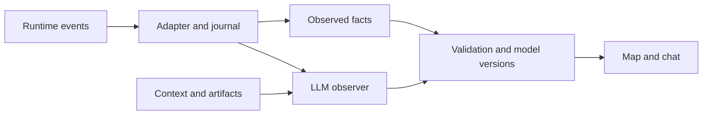

# RFC: aang — human observability of an agentic task

## 1. Proposal

aang is a daemon with a web interface that runs next to an agent runtime. It turns the events of a long run into an updating semantic graph: a map of the task's meaningful stages and their relations. It shows what is being done, by whom, what came out of it, on what basis, and what needs human attention. The MVP supports Claude Code and Codex; OpenCode is planned next.

Long scenarios include research, code, testing, several environments, review and retries. Behavior is defined by hierarchical CLAUDE.md/AGENTS.md, skills, hooks, subagents and MCP. In in-house cloud harnesses the same tools become the execution environment for autonomous tasks. The user sees messages about individual actions but loses the link between them and their goal.

The problem arises twice. During work it is unclear which stage is under way, who is doing it and whether intervention is needed. After a long iteration the context has to be reassembled from the report, the results and the open questions. A graph of all calls keeps this burden. A person spends attention on reconstructing the process before getting to decisions.

**Product hypothesis:** aang can cut the human effort of understanding and supervising a long run several-fold and let one engineer handle more tasks without losing control. The mechanism is to continuously maintain a compact model of the task, show changes and direct attention to questions that need a decision. Instead of rereading the history, a person studies the stages that changed and expands the evidence when needed.

The hypothesis concerns primarily the time spent on restoring context, observing and reviewing results. The overall gain depends on the share of this work: expertise, decisions and review do not go away. Growth in the number of supervised tasks is possible if human attention was the constraint. The size of the effect and the impact of observer errors must be measured.

## 2. Two scenarios and an example

**During work.** The engineer sees the active stages and agents, known waits, recent changes and data freshness. From a stage they open a short explanation, inputs and outputs, timing, available token usage and the source events.

**After a long iteration.** The «С последнего просмотра» ("Since last view") mode shows new results, revised decisions, questions and review requests. The agent's final text is broken down into cards linked to stages; the original remains available. The order of attention is explained by dependencies, and a priority suggested by the LLM is marked as a recommendation.

For example, after an hour of work on a data pipeline the map shows: "Sources studied", "Pipeline implemented", "Checks running", "Publication awaiting decision". Inside the check, two subagents and the result of a specific run are visible. The message "all done" does not hide a failed data check. The request "collapse the reviewers" removes detailed actions while keeping their substantive remarks in the attention zone. This is an illustration of the interface, not a fixed workflow.

## 3. What already exists

A graph and a chat by themselves do not distinguish aang from existing products. Langfuse builds a graph from observations and can merge repeated calls by name; LangSmith Chat answers questions about traces and conversations. These are candidates for comparison and possible reuse, not proof of a free niche. [Langfuse Agent Graphs](https://langfuse.com/docs/observability/features/agent-graphs), [LangSmith Chat](https://docs.langchain.com/langsmith/chat).

Graphectory studies semantic and temporal relations, including building the graph during work. Its results on intervening in the agent cannot be carried over to an observing aang. TRAIL shows how hard it is to diagnose long trajectories for the models studied; it does not prove the quality of our analyzer. Practical conclusion: test the usefulness of the interface and the reliability of its conclusions separately. [Graphectory](https://arxiv.org/abs/2512.02393), [TRAIL](https://arxiv.org/abs/2505.08638).

The proposed differentiator of aang is a stable model of the user's task on top of different runtimes: stages, results, evidence and human attention. We test whether it gives an advantage over an ordinary short LLM summary of the same data. Until then, a dedicated product remains a hypothesis.

## 4. MVP scope

| Area | MVP boundary |
| --- | --- |
| Scenarios | Both: observation and returning to results |
| Runtimes | Claude Code and Codex; OpenCode after the MVP |
| Surfaces | Desktop, CLI and the agent SDKs of both runtimes: Claude Agent SDK and Codex SDK |
| Environment | Locally and on one's own VMs/Docker, including the corresponding Desktop modes; vendor clouds excluded |
| Connection | Prior setup of hooks, plugins and event collection is acceptable |
| Interface | Stage map, attention zone, inspector, chat and changes mode |
| Chat | Explanations with links; hiding, collapsing, grouping and changing the level of detail |
| Permissions | Observation and chat with aang only; replies and commands to the solver stay in the original session |
| Observer | The primary path is an already authorized Claude Code or Codex CLI |

Controlling the solver and arbitrarily changing the graph model are not part of the agreed MVP. Launching workflows, notifications, a central organization overview and collaboration are possible extensions that this RFC does not propose to include. Domain logic comes from the task environment; aang is not tied to a data pipeline framework.

Desktop is an MVP commitment. If the data is insufficient for a chosen mode, this limitation must be brought up for a decision rather than silently excluding the surface. SDK support does not mean support for an arbitrary application on the low-level model API.

## 5. Map and chat

The main view is a compact interactive map of stages that expands into subtasks and dependencies. The specific layout is tested on a prototype. Shipping a separate timeline and several graph views at the same time is not required to test the main hypothesis.

A stage has a name, an expected result, a short summary, a state, participants and evidence. Selecting it opens an inspector with details and a local chat. Color is complemented by a label or an icon. Updates preserve the selected stage and the reading position; the history explains merging, splitting and revising stages.

The last-view mark is stored explicitly: the arrival of new events does not mean the user has read them. The attention zone holds explicit questions, review requests and substantial blockers. The absence of a check does not by itself create a task for a human.

The chat answers about the whole run; selecting a stage narrows the context. For example: "Why is the publication awaiting a decision?" The answer refers to a specific version of the map, contains links to evidence or reports a lack of data. A change of view is stored as a reversible rule, applies to new events and does not rewrite history. Hidden agents keep their contribution to results and usage; important questions remain visible. "Viewed" does not mean "approved" and sends nothing to the solver.

## 6. Model and reliability

The unit of observation is a **run**: work on one user goal. It may include session continuations and subagents. Links are established by runtime identifiers or by explicit binding; a matching project directory is not enough.

The model links stages, agents, actions, artifact versions and questions to source events. Several agents can take part in one stage; one agent can take part in several. Nesting, result dependency and temporal sequence are distinguished. Order in time does not prove a causal link.

Three things are shown independently:

- **Execution:** planned, running, waiting, completed, error, cancelled or unknown.
- **Basis of a conclusion:** an observed event, a solver's claim or aang's interpretation.
- **Human decision:** requested, accepted or rejected, if this is visible in the original session.

"14 tests passed" confirms a specific check, not the whole goal. Marking a "criterion confirmed" requires the criterion itself, suitable observed evidence and the version of the result. The criterion is taken from the assignment, an explicit plan or a configured verification contract. Automatic confirmation is possible under such a contract; if only the LLM judged the sufficiency of the evidence, it remains its interpretation. Partial confirmation is shown as partial. In the absence of evidence, «агент сообщил о завершении» ("agent reported completion") is kept.

A test on old code does not automatically confirm the current changes. If only a mutable path or URL is known, this is indicated; a link does not substitute for a stored version. Likewise, a successful SQL query does not prove that a business conclusion is correct.

Silence does not mean a hang. The interface distinguishes a known wait, the absence of new events and the loss of a source. A plan may be missing or change; stages reconstructed by the LLM are marked. A completion percentage and an end-time forecast are not proposed for the MVP. Hidden reasoning is not reconstructed: the available messages, events and the observer's own summary are used.

## 7. Architecture and integrations

The software daemon collects and normalizes events, stores cursors and the model, and serves the web interface. The LLM observer receives new events, relevant context and the current stages, then proposes structured changes with links to sources. The daemon validates the schema, identifiers and model version, applies the changes and keeps the history. Such validation limits structural errors but does not prove that the meaning is correct.

Analysis uses small batches of events with a timer, so that rare events do not wait for the window to fill. The observer can consult the source records and artifact versions; the chain of previous summaries does not become the only source. On replanning, the old approach is kept as superseded. Recovery replays the stored model changes rather than requiring identical LLM answers on a rerun.

The context includes the permitted project instructions, skills, subagent definitions, hooks/MCP settings, Git and reports. Structured progress records and Git are also used in the approach to long tasks described by Anthropic. For aang this is a reason to consider several sources. The presence of a skill in a directory does not prove that it was read or executed. [Anthropic: long-running harnesses](https://www.anthropic.com/engineering/effective-harnesses-for-long-running-agents).

| Runtime | Documented path; what else to verify |
| --- | --- |
| Claude Code | Hooks and transcripts, including subagent events; verify the chosen modes and data completeness. [Hooks](https://code.claude.com/docs/en/hooks), [sessions](https://code.claude.com/docs/en/sessions) |
| Codex | Events of a managed App Server and the JSONL stream of a headless run; file collection is a candidate for existing sessions. Verify connecting without changing how they work. [App Server](https://learn.chatgpt.com/docs/app-server), [non-interactive mode](https://learn.chatgpt.com/docs/non-interactive-mode) |
| Desktop and SDKs of both runtimes | Separate verification of events and child sessions. Claude documents shared hooks for Desktop and CLI, but this does not replace verifying the adapter. [Claude Desktop](https://code.claude.com/docs/en/desktop#shared-configuration) |

Documentation confirms that interfaces exist, but not that aang's adapters are ready. Support is declared for a specific version and launch method after verification: tool events, child agents, usage, continuation, context compaction and reconnection. Every required surface must pass both user scenarios, including work with subagents and results. Unavailability of individual metrics is acceptable with an explicit mark; inability to perform the main scenario blocks a claim of support. Unknown records are stored, gaps are visible in the UI.

Local storage, for example SQLite, and an update stream, for example SSE, are reversible technical candidates. The primary observer backend runs an already authorized Claude Code or Codex CLI in an isolated context with structured output. Integration verification must confirm the isolation, authorization, latency and usage of exactly this path. If the requirements are not met, an alternative backend is brought up for approval.

## 8. Freshness, access and costs

The proposed target is a semantic update within 30 seconds for 95% of labeled control events that should change the map, on a chosen load profile. A missed update counts as a violation. Measurement starts when the event becomes available to the collector. When the time of the event itself is known, the full latency is measured separately. An explicit input request is displayed without waiting for the LLM. This is a candidate acceptance criterion, not a confirmed characteristic.

On an LLM failure, the daemon keeps collecting, shows the observed facts and the age of the semantic model. After a restart it restores cursors, stages and view state. Redelivery does not create duplicates; unrecoverable gaps are not filled with guesses. Queues and retries are bounded. The event collector must not block the solver's work when aang fails.

The observer reads only the selected sources; instructions inside a transcript are treated as data. It is isolated from the solver's permissions and excludes its own sessions from observation. Writing is allowed to its own storage. A remote UI requires secure access. Permitted models, transmitted data, masking and retention period are agreed before connecting working sessions.

Usage of the solver, the observer and the chat is accounted for separately. In the absence of an exact attribution of tokens to a stage, the session usage or a marked estimate is shown. One action is not summed twice; the duration of a run differs from the sum of the times of parallel agents. The monetary cost under a subscription may be unknown. Economics are assessed by measurements per active hour, without promising cheapness in advance.

## 9. How to test the hypothesis

Two independent tests are needed. **Technical:** each required mode delivers sufficient events; the map and chat work under parallelism, replanning, context compaction, disconnects and restart. **Product:** authors of long runs understand the work faster and more correctly and can supervise more tasks with the same attention budget.

For the product test, the original interface, a short LLM summary and aang are compared on the same data. At chosen points in the recordings, without future events, a person determines the current work, the result and its basis, an unresolved question and the need for intervention. The answer "no intervention is needed now" is also valid. The order of the interfaces is varied to reduce the memorization effect. Disputed cases are reviewed by people familiar with the task.

| Hypothesis | What to measure |
| --- | --- |
| Context is restored several times faster | Time to correct answers and total time spent supervising a run; ratio to the original interface and to a simple summary |
| More tasks can be handled | Number of comparable tasks with the same attention time, accounting for missed questions, reaction delays and decision errors |
| Observation stays reliable | False confirmations, lost questions, excess noise and chat answer errors |
| State is visible during work | Update latency, share of time with lag and event completeness in live runs |

Faster individual answers do not yet prove higher productivity: the latter is tested on live work with several tasks. Effort includes setting up the connection and views, checking doubtful conclusions and fixing aang's errors; one-off and recurring costs are counted separately. Synthetic recordings test invariants but do not confirm the product effect. In control scenarios, a false confirmed success and the loss of an explicit blocking question are unacceptable.

The specific data, participants and thresholds have not been chosen yet; they are fixed before the evaluation. Continuing is justified if understanding becomes faster without loss of correctness. If there is a gain only in some scenarios, the concept can be narrowed. If a simple summary gives a comparable result, the need for a separate interactive product should be reconsidered.

## 10. What remains to be verified

Main risks: a plausible but wrong map; overloading the user again; incomplete events; observer lag and usage. They are matched by verifiable evidence, gradual disclosure of details, trials of each adapter and separate measurements of freshness and costs. The existence of a new interface by itself does not reduce human work.

Before working runs, the permitted data, transfer and retention rules, CLI authorization conditions and acceptable usage must be defined. These conditions diverge in the source materials and are not yet agreed; the RFC claims neither the absence of restrictions nor readiness for enterprise deployment.

What is put up for review is the concept: maintain a live semantic model of the task and use it as an interface for understanding, verification and distributing attention. The MVP scope is fixed in section 4. The feasibility of each integration and the hypothesis of a multiple-fold gain are tested separately; changing the agreed scope requires a separate decision.
